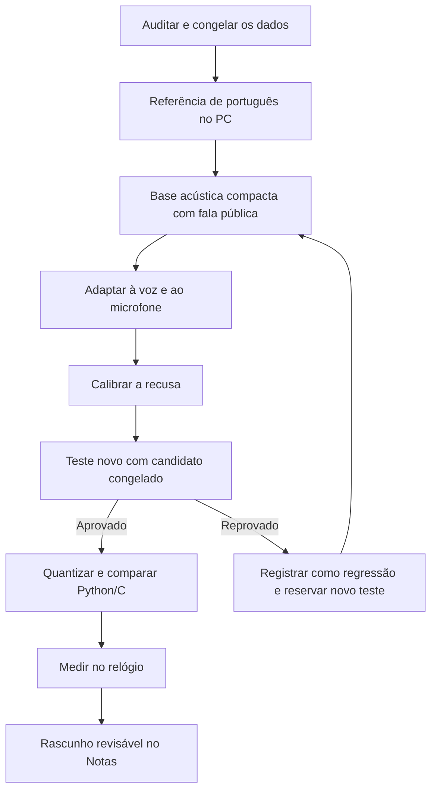

# Fluxo de evolução do reconhecimento de voz

**Pausado em 07/11/2026 por solicitação do usuário, para testes de GPS.**
Estado preservado e instruções de retomada em [voice-pause-20261107.md](voice-pause-20261107.md).

## Decisão principal

O próximo ciclo deve partir de uma **base acústica em português** e usar a voz
pessoal para adaptação e validação. O fluxo inicial exigiu generalização de
redes treinadas do zero com poucos áudios e alvos fonéticos automáticos. Essa
foi uma premissa fraca: acertar o treino não demonstrou entender sons novos.
Não vamos usar o número de fonemas cobertos como prova de aprendizado.

O objetivo permanece: reconhecimento em português inteiramente offline no
ESP32-S3, evoluindo de palavras para rascunhos de notas revisáveis. Preparação,
treinamento e modelos de referência podem rodar no PC. A execução final no
relógio precisa ser demonstrada com medições, não presumida pelo tamanho dos
pesos. Os limites de tela, DMA e memória de `AGENTS.md` continuam obrigatórios.

## O que já está disponível

Auditoria em 07/11/2026, sem alterar as sessões:

| Material | Quantidade | Uso atual |
| --- | ---: | --- |
| Piloto de palavras | 80 | Treino/regressão conhecida |
| Calibração de palavras | 80 | Desenvolvimento/calibração já consultada |
| Contextos fonéticos | 45 | Treino exploratório, alvos ainda provisórios |
| Total | 205 | Formato e hashes verificados entre as duas raízes |

São 410 segundos de WAV, incluindo pausas e silêncios; não são 410 segundos
de fonemas pronunciados. Há 100 gravações com texto esperado, 50 de fala
fora do vocabulário sem transcrição e 55 de silêncio. Nenhuma sessão foi
reservada como avaliação independente até aqui.

O melhor piloto fonético acertou 2/30 palavras ao buscar no léxico completo
de 200. O controle por exemplos e alinhamento temporal chegou a 20/30 palavras
na calibração, mas ainda apresenta falsas aceitações. Esses artefatos são
referências de diagnóstico. Nenhum é um candidato aprovado para o relógio.
Histórico em [`voice-training.md`](voice-training.md) e
[`voice-phonetic.md`](voice-phonetic.md).

## Etapas e critérios de avanço



### 1. Auditar e congelar — implementado

O comando abaixo confere os dois formatos de sessão, hashes de PCM, duplicatas
entre raízes, estatísticas recalculadas e áudios pendentes. Exporta um snapshot
privado e uma fila agrupada por texto para revisão posterior:

```powershell
& '.\.venv-voice\Scripts\python.exe' tools/voice/workflow_status.py --output .pio/voice/workflow-20261107-01
```

Essa saída já existe; use um nome novo ao repetir. Não abre serial, não baixa
modelos, não envia áudio e não modifica rótulos. A fila atual reúne 46 grupos
de texto esperado. Isso não significa que o usuário deva ouvir novamente os
205 arquivos: a próxima etapa deve priorizar divergências e casos suspeitos.
Os sete sons com apenas um ou dois contextos continuam sinalizados.

O progresso é explícito: o auditor confirma integridade; os demais marcos
continuam `pending-evidence` até terem resultados reais. Não infere aprovação
por existir um arquivo de pesos.

### 2. Referência forte no PC — primeira validação executada

Executar localmente um reconhecedor já treinado em português nos áudios atuais.
Começar por uma amostra de cada contexto e por casos discrepantes de nível,
sem iniciar outra rodada de gravações. A hipótese automática vai para um
campo separado: nunca substitui silenciosamente o texto esperado.

Um candidato a referência é
[`jonatasgrosman/wav2vec2-large-xlsr-53-portuguese`](https://huggingface.co/jonatasgrosman/wav2vec2-large-xlsr-53-portuguese),
publicado pelo responsável pelo modelo, com entrada de 16 kHz. A referência
foi baixada e executada localmente nos 205 áudios, acertando 89/100 textos
esperados. Não é um modelo selecionado para o relógio. Resultados, detecção
de fala, limitações e comandos estão no
[relatório de validação](voice-validation-20261107.md). As métricas publicadas
em outro corpus não são uma previsão para nossas gravações curtas.

**Avança quando:** temos transcrições de referência, uma comparação reproduzível
e uma lista pequena de divergências para ouvir. Se a referência também falhar,
investigar áudio, recorte, sotaque e rótulos antes de culpar apenas a rede pequena.
Falhas da referência também não provam que a gravação esteja errada.

Correções revisadas devem gerar uma base derivada versionada, com hash do PCM,
texto original, texto confirmado, origem da hipótese e motivo da mudança.
Os manifests e planos originais ficam imutáveis. O suporte a essa camada de
revisão ainda precisa ser implementado; o auditor apenas prepara a fila.

### 3. Base acústica de português — estudo antes de adaptar

Usar fala pública transcrita para aprender padrões acústicos antes do ajuste
pessoal. Isso segue a direção de pesquisas de
[CTC fonético com corpus geral](https://arxiv.org/abs/1709.03665) e de
[supervisão auxiliar para reconhecimento compacto com poucos exemplos](https://www.isca-archive.org/interspeech_2023/yang23j_interspeech.html).
Esses trabalhos não garantem resultados para o Chronvs.

O primeiro corpus a investigar é
[FLEURS, configuração `pt_br`](https://huggingface.co/datasets/google/fleurs):
fala/transcrição em 16 kHz e licença declarada CC-BY-4.0. Começar por um
subconjunto determinístico e depois ampliar se o experimento justificar.
Registrar revisão da fonte, licença, IDs, hashes e divisão oficial. O corpus
teve um primeiro subconjunto de áudio exportado e usado em treinamento CTC
por caracteres no PC: 128 frases de treino e 32 de validação. Procedimento,
limitações e resultados ficam no [relatório da base pública](voice-public-20261107.md).
Seus metadados foram fixados e conferidos anteriormente na
[validação automática](voice-validation-20261107.md#metadados-da-base-pública).

Já foi implementada leitura de sequências de duração variável e comprimentos
corretos no CTC, com verificação do preenchimento dos lotes. Não recortar uma frase em janelas arbitrárias de dois segundos
e atribuir o texto inteiro a cada janela. Preservar separação por sentença e
as divisões oficiais; versões de uma mesma frase não podem cruzar conjuntos.

Comparar duas representações de saída em uma pequena experiência controlada:
fonemas com pronúncias verificáveis e caracteres/subpalavras com transcrição
textual. O AFI ajuda a planejar e auditar sons, mas não obriga a rede final a
ter fonemas como saídas. O critério é desempenho, custo e facilidade de revisão.

**Avança quando:** um candidato compacto melhora sobre a rede pequena atual
em validação pública reservada, com erros examinados e custo de inferência
estimado. Uma referência grande no PC pode orientar o treinamento, mas sua
compressão/distilação não é automática nem garantia de caber no S3.

### 4. Adaptação pessoal — aproveitar os áudios existentes

Adaptar a base acústica às sessões pessoais de treino, misturando fala pública
para reduzir memorização da ocasião de gravação. Aplicar variações moderadas
de tempo, ganho e ruído somente ao treino; versões aumentadas continuam no
mesmo conjunto que o áudio original. Aumentação não cria novas pessoas ou
novas sessões independentes.

Usar a calibração já conhecida para desenvolvimento. Os 50 exemplos `_unknown`
sem texto servem para estudar recusa; não recebem alvo fonético vazio. Para
treiná-los como fala transcrita, seria necessário confirmar seu conteúdo.

**Avança quando:** o modelo melhora em sessões diferentes e em palavras que o
usuário não gravou para o ajuste pessoal. Distinguir isso de palavras nunca
vistas em qualquer base: a fala pública pode já conter essas palavras.

### 5. Recusa — antes de aceitar qualquer palavra

Uma busca forçada entre 200 itens sempre produz um melhor colocado. Precisamos
comparar esse candidato com silêncio, fala genérica fora do léxico e alternativas
acústicas, usando pontuações normalizadas e limites escolhidos na calibração.
`blank` do CTC não é um rótulo para toda fala desconhecida.

Metas **propostas para o piloto**, ainda não demonstradas:

| Medida | Meta inicial | Significado |
| --- | ---: | --- |
| Precisão entre palavras aceitas | ≥95% | Acertos / todas as aceitações |
| Cobertura correta das palavras válidas | ≥80% | Acertos aceitos / pedidos válidos |
| Falsas aceitações em negativas | ≤5% | Negativas que viraram palavra / negativas |

Relatar contagens e resultados por sessão/ambiente, além dos percentuais.
Poucos exemplos não sustentam conclusões fortes. Recusar tudo não cumpre
a meta de cobertura. Esses limites são critérios de trabalho, não garantias
de confiabilidade ou números já alcançados.

### 6. Coleta complementar e teste novo — somente com uma pergunta clara

Se faltarem dados, o relatório deve dizer qual som/contexto, condição e erro
justificam a coleta. Preparar blocos curtos, por exemplo de 5–10 itens, usando
o modo sem Enter já existente. O usuário lê, toca no relógio e usa `r` para
repetir. A revisão deve pedir atenção aos casos conflitantes, não repetir toda
a coleta por padrão.

Quando o candidato passar na calibração, congelar pesos, preparação e limites.
Só então gravar uma sessão reservada, com exemplos diferentes, palavras fora
do ajuste pessoal, silêncio e fala fora do léxico. O roteiro reservado de
20 palavras pode ser ponto de partida, após conferir sobreposição com a nova
base. Quantidade, sessões e condições precisam constar do relatório.

Se o teste for usado para corrigir o modelo, ele passa a ser regressão
conhecida. Reservar novos casos para uma nova alegação de generalização.

O modo atual continua com dois segundos. Frases mais longas exigirão uma
variante explícita de captura e formatos compatíveis, com duração revisada;
não pedir que a pessoa corra ou corte a fala para caber.

### 7. Exportação e relógio — comprovação separada

Comparar os mesmos áudios e vetores em Python e C. Depois da quantização,
repetir as métricas, em vez de presumir equivalência. Medir memória interna
livre/maior bloco DMA, PSRAM, pilha, tempo por quadro e efeitos sobre a interface.
Preservar buffers, QSPI síncrono e configuração LVGL validados no dispositivo.

**Avança quando:** o modelo validado cabe e responde em tempo adequado no S3,
com áudio, interface, parar/sair, apagar/acordar e sessões repetidas testados
fisicamente. O orçamento final de bytes/latência será fixado com medições do
firmware; os 89 kB de pesos do protótipo não medem o consumo total.

### 8. Notas — rascunho antes de persistência

Depois do reconhecimento de palavras, testar sequências curtas e palavras
consecutivas/repetidas. Exibir um rascunho com edição e confirmação, preservando
o texto em caso de erro. Ditado livre, nomes novos e ambiguidade de grafia
continuam como capacidades a avaliar, não consequências automáticas do AFI.

## Estado do fluxo

`tools/voice/workflow.json` registra etapas e metas propostas.
`workflow_status.py` já executou a auditoria das 205 amostras e gerou snapshot
e fila de revisão locais em `.pio/voice/workflow-20261107-01`.
Uma segunda auditoria em `.pio/voice/workflow-validation-20261107-02`
confirma a referência completa no mesmo snapshot de áudios e os metadados
do corpus público. Uma rodada posterior preparou um subconjunto público e
executou o primeiro treinamento compacto. Revisão assistida, uma base acústica
com qualidade útil e promoção continuam pendentes.

A referência e a lista de divergências já foram geradas. O próximo marco
independente de novas gravações é melhorar a qualidade da base compacta a
partir dos resultados públicos, antes de adaptar à voz pessoal.
